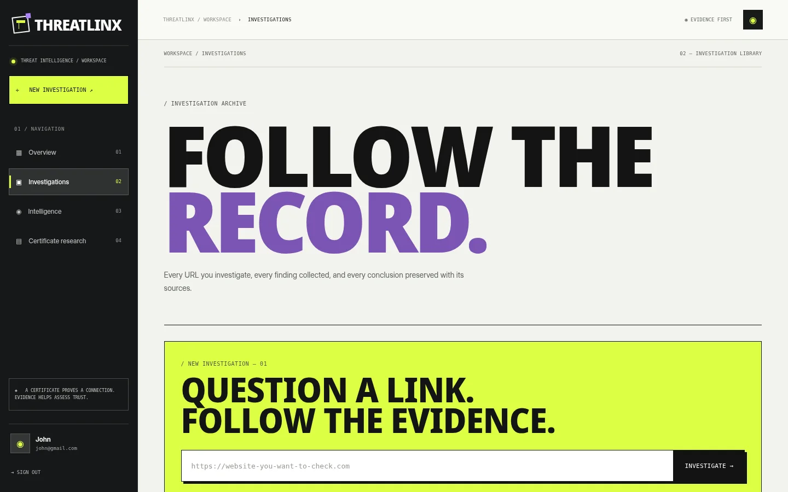
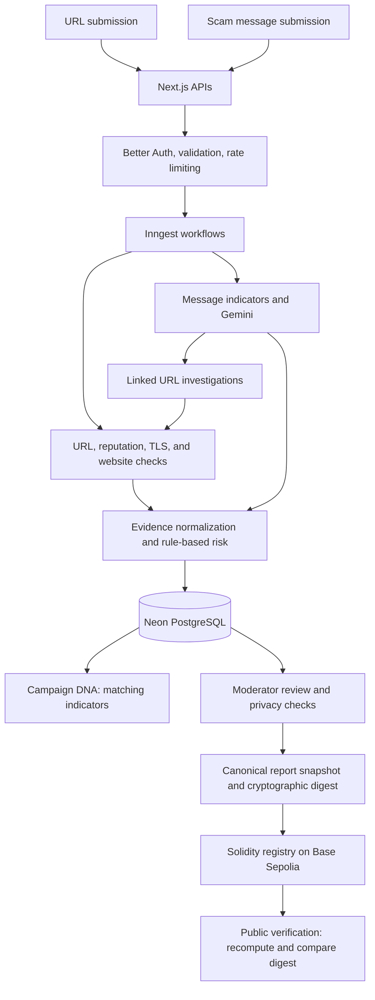

# ThreatLinx

**An AI-assisted web and scam threat investigation platform that correlates security evidence and registers independently verifiable reports on-chain.**

## Problem

Phishing links, fraudulent websites, impersonation messages, and social-engineering scams often look legitimate. A valid HTTPS certificate does not prove that a site is honest, while isolated URL scanners and message classifiers cannot show how related incidents connect. Security findings also need a trustworthy way to preserve the integrity of reviewed reports.

## Solution

ThreatLinx provides one investigation workflow for **suspicious URLs and scam messages**:

- **Investigate websites:** Inspect URL structure, brand lookalikes, known-threat reputation, TLS certificate identity, security configuration, and optional isolated browser evidence.
- **Analyse messages:** Identify social-engineering indicators (impersonation, urgency, credential or payment requests), extract links, and queue qualifying public URLs for investigation.
- **Correlate indicators:** *Campaign DNA* groups cases through observed matching domains and reviewed reports; similarities are evidence for investigation, not proof of a common attacker.
- **Assess risk:** Explain evidence, uncertainty, missing checks, and five classifications: Low Risk, Suspicious, High Risk, Confirmed Malicious, or Inconclusive.
- **Verify reviewed reports:** An authorised moderator can publish a cryptographic evidence commitment to the **Base Sepolia** testnet. Anyone can compare the report snapshot against the on-chain digest using *Proof Registry*.

**Distinctive approach:** ThreatLinx connects message intent to the destination website, traces shared indicators across reports, and makes reviewed evidence *tamper-evident*. Blockchain attests to a record's integrity and registration—not to the truth of a malicious-site claim.

## Demo links and a screenshot

| Resource | Link |
| --- | --- |
| Live demo | **Add deployment URL before submission** |
| GitHub repository | **Add repository URL before submission** |
| Public report verification | `/proof/[report-id]` on the deployed application |
| Base Sepolia contract | **Add deployed contract address and block-explorer link** |



*Workspace screenshot from an earlier design build; replace it with a current deployed-app capture before final submission.*

## Tech stack

| Technology | Role in ThreatLinx |
| --- | --- |
| **Next.js 16, React 19, TypeScript** | Full-stack routes, product application, and API endpoints |
| **Better Auth** | Email/password accounts, sessions, and optional Google OAuth |
| **Neon PostgreSQL + Drizzle ORM** | Persist investigations, evidence, message cases, reviewed reports, and proof records |
| **Inngest** | Durable orchestration and retries for URL, message, and on-chain publication jobs |
| **Gemini (`@google/genai`)** | Explain collected evidence and interpret suspicious-message patterns; not an autonomous authority for final verdicts |
| **Google Safe Browsing + `tldts` + rules** | Known unsafe-URL matches, registrable-domain parsing, and lookalike indicators |
| **Node.js TLS / crypto** | Certificate identity, chain validation, and cryptographic fingerprints |
| **Mozilla HTTP Observatory** | Passive web security posture assessment |
| **urlscan.io** | Optional, privacy-reviewed, isolated browser observations when account permissions permit |
| **Upstash Redis** | Rate limiting on production-facing operations |
| **Solidity + OpenZeppelin** | Access-controlled cryptographic report-commitment registry |
| **Hardhat 3 + viem** | Smart-contract testing, testnet deployment, on-chain reads and writes, and digest verification |
| **Base Sepolia** | EVM testnet for public commitment registration and independent verification |

## Architecture



**Security boundaries:** Website inputs are validated to prevent access to internal networks; external browser scans require appropriate privacy controls. Raw messages, credentials, and private URLs must not be written on-chain. Missing provider results remain unknown, and unverified community allegations do not become confirmed findings.

## Setup and run steps

**Prerequisites:** Node.js **22.13+**, npm, a Neon PostgreSQL database, and credentials for the services you enable. Work from the **repository root** (there is no `src/` folder).

**1. Install dependencies and configure secrets.**

```bash
npm install
cp .env.example .env.local
```

On Windows PowerShell, copy with `Copy-Item .env.example .env.local`. Supply values in `.env.local` (never commit this file):

| Variable | Purpose |
| --- | --- |
| `DATABASE_URL` | Neon PostgreSQL connection URL |
| `DATABASE_MIGRATION_URL` | Optional direct Neon connection for migrations |
| `BETTER_AUTH_SECRET`, `BETTER_AUTH_URL` | Authentication secret and canonical app URL |
| `GOOGLE_CLIENT_ID`, `GOOGLE_CLIENT_SECRET` | Optional Google OAuth |
| `GEMINI_API_KEY`, `GEMINI_MODEL` | AI analysis and explanation |
| `SAFE_BROWSING_API_KEY` | Known unsafe URL intelligence |
| `URLSCAN_API_KEY` | Optional private browser investigation |
| `UPSTASH_REDIS_REST_URL`, `UPSTASH_REDIS_REST_TOKEN` | Production rate limiting |
| `INNGEST_DEV` / `INNGEST_EVENT_KEY`, `INNGEST_SIGNING_KEY` | Local / hosted background jobs |
| `ADMIN_EMAILS` | Comma-separated moderator email allowlist |
| `BASE_SEPOLIA_RPC_URL`, `REPORT_PUBLISHER_PRIVATE_KEY` | Base Sepolia RPC and **testnet-only** publisher key |
| `REPORT_REGISTRY_ADDRESS` | Smart-contract address after deployment |

**2. Create the database tables (new Neon database only).**

```bash
npm run db:migrate:auth
npm run db:migrate:product
npm run db:migrate:intelligence
npm run db:check
```

For an **existing ThreatLinx database**, do not rerun setup blindly. Preserve the Better Auth secret and existing tables; check whether the `0002_intelligence_web3.sql` migration is already applied before running `npm run db:migrate:intelligence`. The product SQL scripts are separate from Drizzle Kit's generated migration journal: do **not** run `drizzle-kit migrate` expecting it to pick up those SQL files. Do not reset the database or use `drizzle-kit push` to initialise an existing authentication schema.

**3. Start the app and local workflow runner (separate terminals).**

```bash
npm run dev
```

```bash
npx inngest-cli@latest dev -u http://localhost:3000/api/inngest
```

Open **http://localhost:3000** and sign in to start an investigation. Optional providers must have valid credentials before their checks can execute.

**4. Set up on-chain reporting (Base Sepolia).**

Use a dedicated **testnet-only** publisher wallet with Base Sepolia test ETH. Configure `BASE_SEPOLIA_RPC_URL` and `REPORT_PUBLISHER_PRIVATE_KEY`, then run:

```bash
npm run contracts:compile
npm run contracts:test
npm run contracts:deploy
```

Copy the actual deployed contract address into `REPORT_REGISTRY_ADDRESS`. After a moderator approves an evidence-backed report, publish its commitment and check the transaction receipt. Use `/proof/[report-id]` to verify that the report snapshot matches the on-chain record. No blockchain transaction is required for ordinary user sign-in or scanning.

**5. Validate before deploying.**

```bash
npm run db:check
npm run typecheck
npm test
npm run lint
npm run build
npm run contracts:test
```

Run live checks of Better Auth, Neon, Inngest, Gemini, security providers, and the deployed contract with your own development credentials. **Source-code syntax checks do not replace these integration tests.** For safe demo scenarios and outstanding checks, see [`docs/TEST-AND-RELEASE.md`](docs/TEST-AND-RELEASE.md).

## Disclosures (libraries, templates, AI tools)

- **Libraries and tools:** The repository uses the packages declared in `package.json`, including Next.js, Better Auth, Drizzle, Inngest, Gemini SDK, OpenZeppelin, Hardhat, and viem. Dependencies remain subject to their respective licenses.
- **Third-party intelligence:** Google Safe Browsing, Mozilla HTTP Observatory, and urlscan.io provide external evidence, subject to provider quotas, terms, privacy requirements, and availability. Safe Browsing usage in this prototype is non-commercial.
- **AI assistance:** Generative AI was used during project development and is used at runtime for grounded explanations and message-pattern analysis. The final security classification is produced by explicit detection logic and corroborating evidence, not by an unconstrained AI agent.
- **Design and templates:** Project-specific frontend components use a cyber-brutalist visual direction; no external paid UI template is claimed as part of this repository.
- **Verification limits:** A blockchain digest proves that the published record has not changed relative to its on-chain commitment; it does not establish that a reported website or organisation is malicious. Live provider, testnet, and database tests must be completed and recorded before claiming end-to-end validation.

## Track

**HackMatrix — Artificial Intelligence × Cybersecurity × Web3 (48-hour challenge).**
